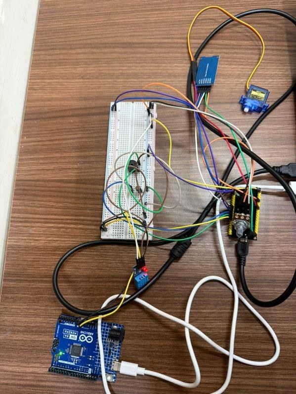
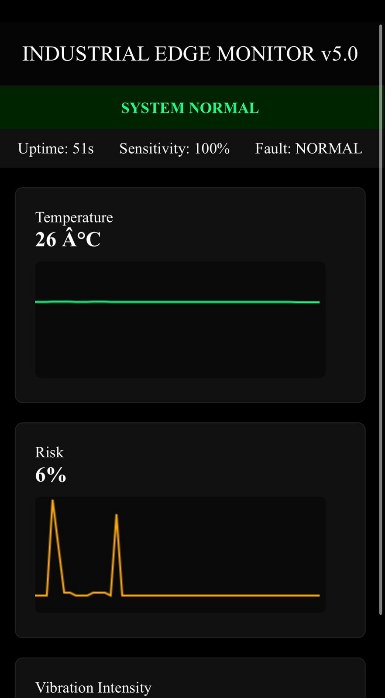
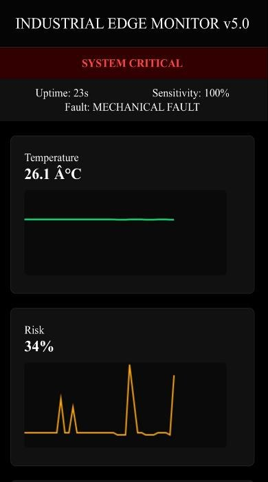
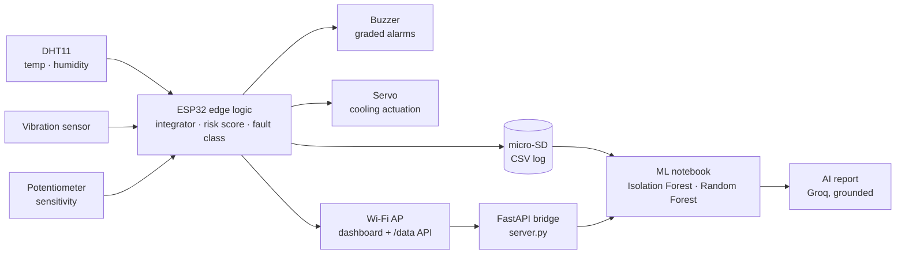

<div align="center">

# Industrial Edge Monitor

### Low-cost ESP32 condition monitoring with on-device fault logic, a live dashboard and an ML predictive-maintenance pipeline






</div>

---

## Why

Small workshops lose production to overheating and mechanical faults that a cheap sensor could have flagged. Industrial monitoring systems usually cost too much and depend on the cloud. This project shows that one ESP32 can sense, decide, alert, act, log and serve a dashboard at the edge, with no internet connection. The data it logs is ready for machine learning.

## What it does

| Layer | Implementation |
|---|---|
| **Sensing** | DHT11 temperature and humidity; vibration switch with a software integrator; potentiometer to set sensitivity live |
| **Edge analytics** | Samples every 100 ms. Computes a risk score from 0 to 100, classifies faults as *Overheat*, *Mechanical* or *Combined*, and sets the alarm level |
| **Actuation** | Graded buzzer (1 Hz beep for WARNING, continuous tone for CRITICAL) and a servo cooling sweep above 30 °C |
| **Logging** | Writes a CSV row to micro-SD every 5 s. The log can be downloaded or cleared from the dashboard |
| **Interface** | Wi-Fi soft access point with a live dashboard (temperature and risk trends, vibration bar, status banner) and a `/data` JSON API |
| **Server bridge** | FastAPI service that receives readings, keeps the latest state and builds a training log |
| **ML** | Isolation Forest for unsupervised anomaly detection, plus Random Forest models for alarm level and risk score |
| **AI reporting** | Maintenance reports and Q&A from a Groq LLM that only sees computed statistics, with an offline fallback |

## Architecture



## Edge decision logic

| Signal | Rule |
|---|---|
| Vibration integrator | +2 per 100 ms while the sensor is triggered and −3 otherwise, limited to 0–20. This filters out single-spike chatter |
| Vibration threshold | Set from the potentiometer, between 2 (most sensitive) and 18 |
| Risk score | `min((T − 25) × 6, 80)` plus `min(intensity × 4, 80)` when vibration is detected, capped at 100 |
| Fault type | Combined if T ≥ 35 °C **and** vibration; Overheat if T ≥ 35 °C; Mechanical if vibration only |
| Alarm level | **CRITICAL** if T ≥ 35 °C or vibration; **WARNING** if T ≥ 30 °C; otherwise NORMAL |
| Cooling | Servo sweeps 0–180° while T > 30 °C |

## Hardware and wiring

| Component | ESP32 pin |
|---|---|
| DHT11 data | GPIO 4 |
| Vibration sensor (digital out) | GPIO 17 (input pull-up) |
| Buzzer | GPIO 16 |
| Potentiometer wiper | GPIO 34 (ADC) |
| SG90 servo signal | GPIO 33 |
| micro-SD module | CS GPIO 5 · MOSI 23 · MISO 19 · SCK 18 |

## ML results (1,000 logged readings)

**Unsupervised.** Isolation Forest never sees the alarm labels, yet it flags **98 of the 110** CRITICAL readings while raising only **2** alarms on the 890 NORMAL readings.

| Firmware level | Not flagged | Flagged |
|---|---:|---:|
| NORMAL | 888 | 2 |
| CRITICAL | 12 | 98 |

**Supervised.** A Random Forest reproduces the alarm level (100% on the test set) and the risk score (MAE 0.27, R² 0.998). These scores are expected: the firmware derives both values from the same sensors using fixed rules. The notebook is a template. Once real failure labels are logged, the same code trains a genuine predictive model.

## Quick start

**Firmware.** Open `firmware/IndustrialEdgeMonitor/IndustrialEdgeMonitor.ino` in the Arduino IDE. Install *DHT sensor library*, *Adafruit Unified Sensor* and *ESP32Servo*, select **ESP32 Dev Module** and upload. Join the `IndustrialMonitor` Wi-Fi network and open `http://192.168.4.1`.

**Server bridge**
```bash
cd backend && pip install -r requirements.txt
uvicorn server:app --host 0.0.0.0 --port 8000
```

**ML and AI reports**
```bash
cd ml && pip install -r requirements.txt
jupyter notebook predictive_maintenance.ipynb
export GROQ_API_KEY=...      # optional; an offline report is produced without it
python ai_report.py          # writes reports/industrial_ai_report.{txt,pdf}
python ai_report.py --chat   # Q&A over the device evidence
```

## Repository structure

```
Industrial-Edge-Monitoring/
├── firmware/IndustrialEdgeMonitor/   # ESP32 firmware: sensing, logic, alarms, servo, SD, web UI
├── backend/server.py                 # FastAPI bridge and CSV training log
├── ml/
│   ├── predictive_maintenance.ipynb  # Isolation Forest + Random Forest (executed)
│   └── ai_report.py                  # grounded LLM report and Q&A
├── data/
│   ├── industrial_dataset.csv        # 1,000 readings logged by the device
│   └── device_log_sample.csv         # raw log from an early bench test
└── docs/images/
```

## Roadmap

- Replace the vibration switch with an accelerometer (MPU6050) for frequency-domain features
- Collect real failure labels for true remaining-useful-life prediction
- Send telemetry over MQTT so several machines can share one dashboard

---

<div align="center">
<b>Sai Siddhanth</b> · Embedded Systems project, VIT Vellore<br/>
<a href="https://www.linkedin.com/in/sai-siddhanth-67912628b">LinkedIn</a> · <a href="https://github.com/saisiddhanthks">GitHub</a>
</div>
